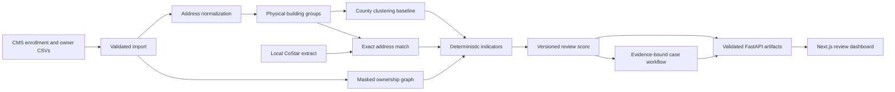

# Architecture

The scoring and investigation layers are deterministic. Missing sponsor data is represented explicitly and available weights are rebalanced. Case findings can only use attached evidence records and fixed neutral language. The dashboard and APIs display screening priorities, not fraud conclusions.
